# 双重预防机制操作手册

| 项目 | 内容 |
|---|---|
| 适用产品 | 智能安全管控平台 |
| 适用模块 | 双重预防机制 |
| 读者对象 | 企业安全管理员、双预防机制配置人员、巡检任务执行人员 |
| 文档版本 | V0.1（草稿） |
| 更新日期 | 2026-10-26 |

> 本手册按“功能说明 → 前置条件 → 操作步骤 → 结果查看 → 常见问题”组织。截图中的企业名称已做模糊处理，其余为演示环境数据。
>
> 图中红色编号 ①② 标记关键操作位置，短标签说明该位置的操作内容，与对应步骤一一对应。

## 一、模块概览

双重预防机制模块用于建立“风险分级管控 + 隐患排查治理”体系：先在系统中维护风险分析对象、分析单元和管控措施，再按巡检计划下发双预防巡检任务，执行中发现的问题进入隐患治理流程，并通过奖惩绩效、三率一量和园区任务完成考核与上报。

| 功能组 | 包含功能 | 作用 |
|---|---|---|
| 基础配置 | 风险分析对象、风险分析单元、管控措施分类、排查库、风险四色图 | 建立风险台账和分析基础 |
| 风险清单 | 风险安全清单、分级管控清单 | 报表化展示风险与管控措施 |
| 任务管理 | 巡检点、巡检计划 | 按计划下发并执行双预防巡检任务 |
| 隐患治理 | 隐患登记、异常上报、隐患治理配置 | 隐患发现、整改、闭环 |
| 绩效与上报 | 奖惩绩效、三率一量、园区任务 | 考核统计与数据上报 |

## 二、风险分析对象

### 2.1 功能说明

风险分析对象是双重预防机制分析的基础。系统按“风险分析对象 → 风险分析单元 → 管控措施”逐级组织，风险分析对象通常对应一个区域、装置或场所。

### 2.2 前置条件

| 条件 | 说明 |
|---|---|
| 危险源已维护 | 需要关联危险源时，先在危险源管理中维护 |
| 区域已维护 | 需要关联区域时，先在区域管理中维护区域名称、区域类型和区域性质 |
| 人员在册 | 责任人取自系统在职员工数据 |

### 2.3 操作步骤

**菜单路径：** 双重预防机制 → 风险分析对象

步骤 1：进入风险分析对象列表，点击【新增】。

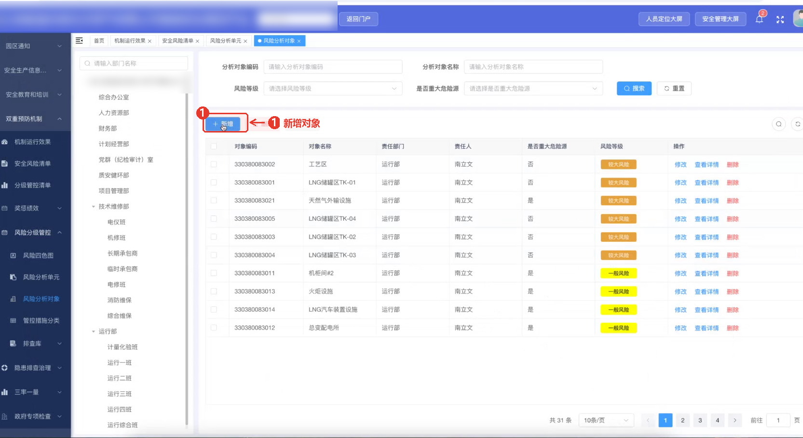

步骤 2：填写风险分析对象信息。

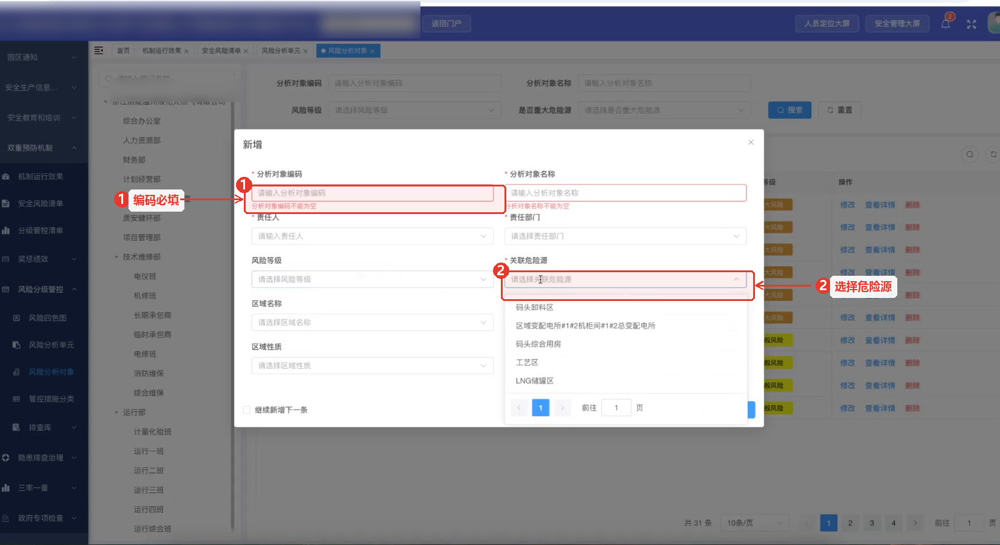

| 字段 | 必填 | 说明 |
|---|---|---|
| 分析对象编码 | 是 | 系统内唯一 |
| 风险分析对象名称 | 是 | 按企业管理口径自定义 |
| 责任人 | 是 | 取自在职员工数据 |
| 责任部门 | 是 | 支持多选 |
| 风险等级 | 是 | 重大风险、较大风险、一般风险、低风险 |
| 关联危险源 | 否 | 取自危险源管理 |
| 区域名称 | 否 | 取自区域管理；受区域编码限制 |
| 区域类型、区域性质 | 否 | 与区域管理维护内容一致 |

步骤 3（批量导入）：下载模板填写后导入。模板内容与系统内新增一致；人员列支持姓名、工号或身份证号，存在重名时建议使用工号或身份证号。

### 2.4 列表说明

列表按更新时间排序：新维护的数据在上，历史数据在下。支持按分析对象名称、责任部门等条件查询。

### 2.5 常见问题

| 现象 | 排查方法 |
|---|---|
| 区域下拉为空 | 先在区域管理中维护区域 |
| 人员选不到 | 先在在职员工数据中维护责任人 |
| 保存提示编码重复 | 分析对象编码在系统内必须唯一 |
| 导入失败 | 检查模板列名、必填项和人员列的填写格式 |

## 三、风险分析单元

### 3.1 功能说明

风险分析单元是风险分析对象下的细分单元，一个对象可对应多个单元。单元维护后，风险安全清单和巡检任务都按“对象—单元”组织。

### 3.2 操作步骤

**菜单路径：** 双重预防机制 → 风险分析单元

步骤 1：点击【新增】，填写单元信息。

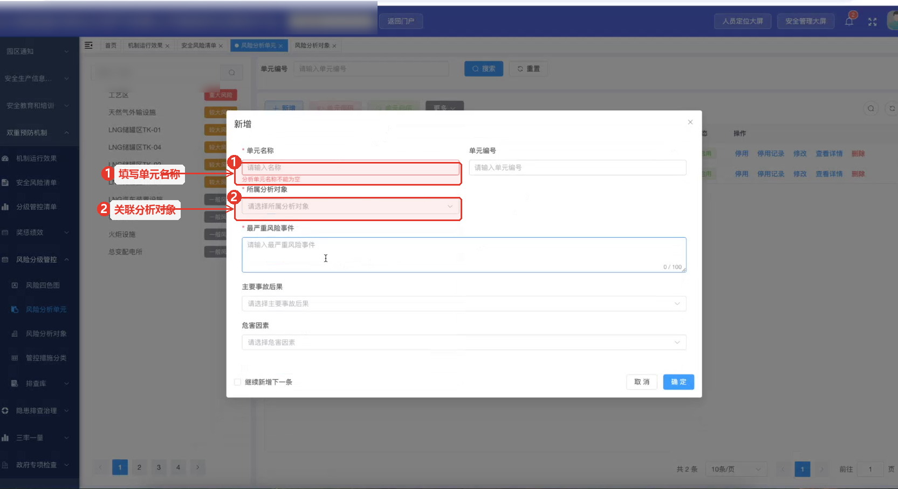

| 字段 | 说明 |
|---|---|
| 单元名称 | 按企业管理口径填写 |
| 所属分析对象 | 关联已维护的风险分析对象 |
| 最严重风险事件 | 从单元内多项风险中选择最严重的一项 |
| 主要事故后果 | 填写该风险事件可能导致的后果 |
| 危害因素 | 可填写多项，多个值用逗号分隔 |

步骤 2：保存后返回列表，列表中可查看单元与对象的对应关系及风险等级。

### 3.3 停用与启用

- 支持勾选指定单元批量停用或启用；
- 停用需填写停用原因，停用记录可查询；
- 启用时系统自动带出结束时间；
- 停用期间，该单元不纳入双重预防机制运行评估的计算范围。

停用适用于集中检维修等场景：相关设备在检修期间无需执行日常双预防巡检，可通过批量停用避免产生无效任务。

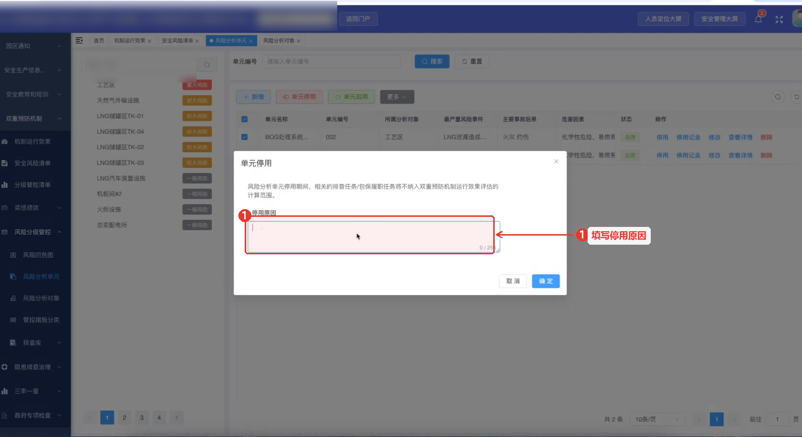

### 3.4 常见问题

| 现象 | 排查方法 |
|---|---|
| 所属分析对象选不到 | 先在风险分析对象中维护 |
| 停用后任务仍生成 | 确认停用是否保存成功，检查该单元是否仍在计划范围内 |
| 启用后未恢复任务 | 确认启用时间与计划周期是否匹配 |

## 四、管控措施分类与排查库

### 4.1 管控措施分类

管控措施分类用于对管控措施分级归类，是巡检计划中检查项目关联的基础。

- 系统初始化数据满足国家双重预防机制建设指南要求；
- 一级、二级分类为国家规定内容，通常不可随意调整，且与双预防数据上报省平台强相关；
- 企业可在此基础上新增下级分类，支持系统内维护和导入导出；
- 巡检计划中的检查项目需要关联管控措施分类，其中一级必填，二级、三级可选。

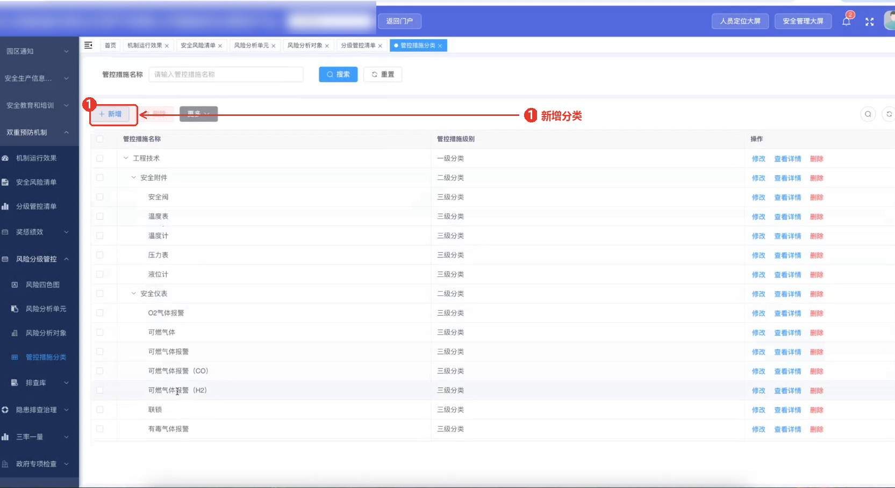

### 4.2 排查库

排查库用树形结构维护排查对象、排查内容和选择依据，并可为选项类内容配置正确答案。排查库维护后，由隐患排查库引用。

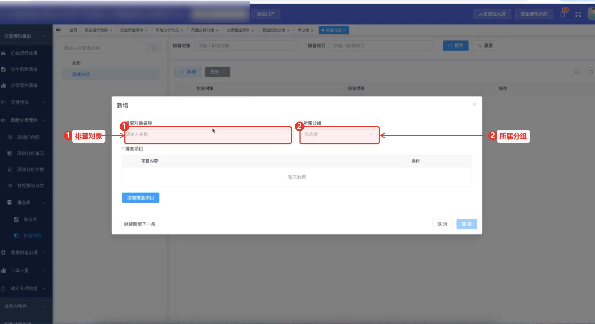

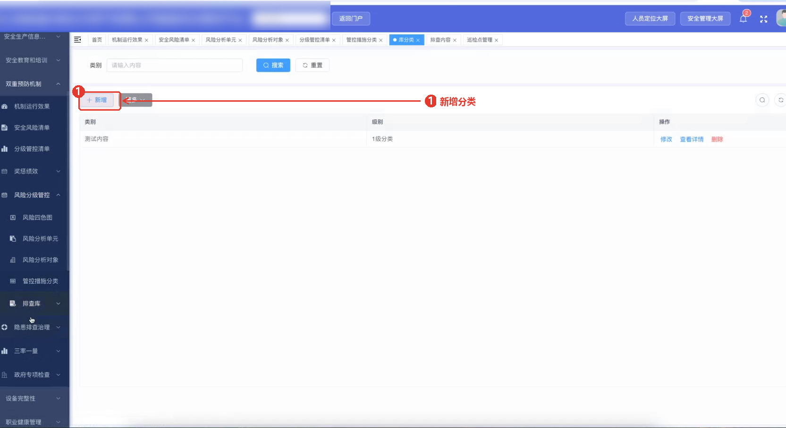

| 操作 | 说明 |
|---|---|
| 新增分组 | 按对象或场景建立分组 |
| 新增排查内容 | 填写排查内容、选择依据和可选项 |
| 配置正确答案 | 选项类内容可设置正确答案 |
| 预览使用 | 保存后可在隐患排查库中选择使用 |

### 4.3 常见问题

| 现象 | 排查方法 |
|---|---|
| 检查项目关联不到分类 | 确认一级分类已维护并启用 |
| 排查库内容在隐患库中看不到 | 确认排查库数据已保存，且隐患排查库已刷新 |
| 分类被改动后上报异常 | 一级、二级分类与省平台上报关联，需谨慎调整 |

## 五、风险四色图与风险清单

### 5.1 风险四色图

风险四色图用于在企业管理平面图上展示风险分布，并用于数据上报。上传企业平面图后，按风险等级在图上进行标注维护。

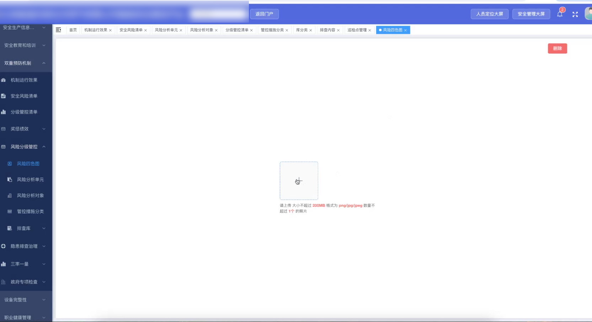

### 5.2 风险安全清单与分级管控清单

- **风险安全清单**：在完成风险分析对象和风险分析单元配置后自动形成的报表，以报表形式直观展示对象及其下属单元；
- **分级管控清单**：通过巡检计划大表导入后形成，展示分析对象、责任部门、责任人、分析单元、最严重风险事件、管控措施分类、隐患排查内容、岗位负责人和推送周期等信息。

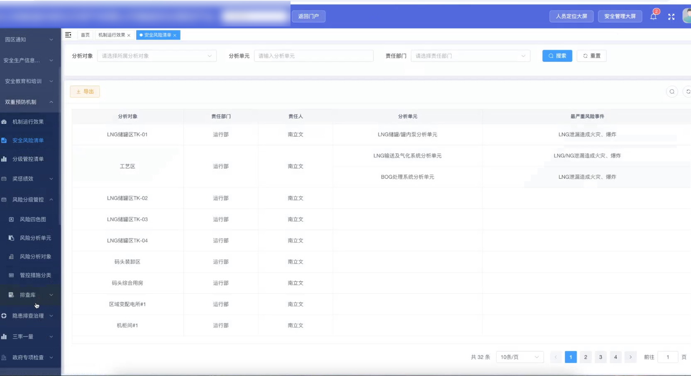

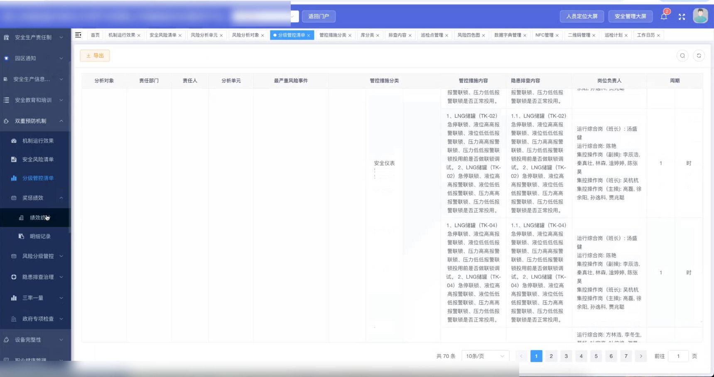

### 5.3 常见问题

| 现象 | 排查方法 |
|---|---|
| 风险安全清单数据不全 | 检查对象与单元是否都已维护完整 |
| 分级管控清单为空 | 检查巡检计划大表是否已导入成功 |
| 四色图无法上传 | 检查图片格式和大小是否符合系统要求 |

## 六、巡检点

### 6.1 功能说明

巡检点是任务下发的最小点位。双重预防机制与智能巡检共用巡检点维护入口，因此需要区分“双预防巡检点”和“日常巡检点”。

| 类型 | 说明 |
|---|---|
| 双预防巡检点 | 执行属地应急管理部门下发的双预防任务，点位需关联风险分析单元 |
| 日常巡检点 | 企业自身设备日常巡检，不参与双预防机制评估 |

签到方式支持三种：

| 签到方式 | 说明 |
|---|---|
| 扫码签到 | 系统生成二维码，张贴在对应设备或区域，现场扫码后解锁巡检内容 |
| NFC 签到 | 使用具备 NFC 功能的防爆终端刷卡签到 |
| 人员定位签到 | 通过人员实时定位判断是否在指定区域内，在区域内才可签到 |

二维码与 NFC 标签在平台底座中维护，支持系统内新增和批量导入导出。

### 6.2 操作步骤

**菜单路径：** 双重预防机制 → 巡检点

步骤 1：进入巡检点列表，点击【新增】。

步骤 2：填写巡检点信息。

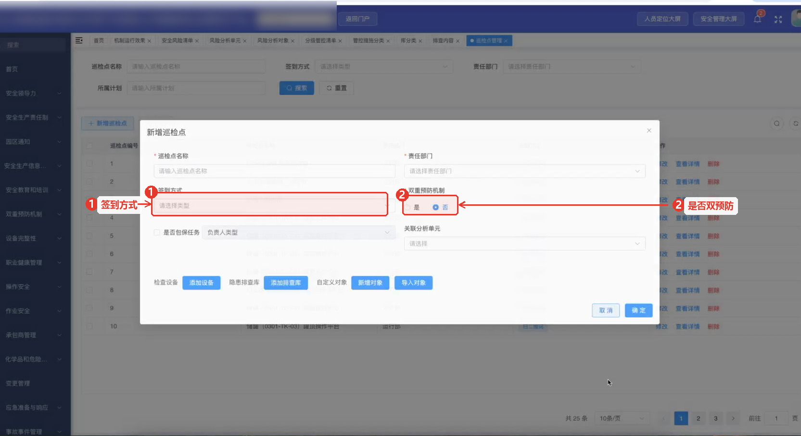

| 字段 | 说明 |
|---|---|
| 巡检点名称 | 按点位实际位置命名 |
| 责任部门 | 选择负责该点位的部门 |
| 签到方式 | 扫码、NFC 或人员定位；选择后补充二维码或定位区域 |
| 双重预防机制 | 选择“是”为双预防巡检点，“否”为日常巡检点 |
| 是否强制签到 | 控制是否必须先签到才能执行巡检 |
| 关联风险分析单元 | 双预防巡检点需关联；日常巡检点按需关联 |

步骤 2：保存后在列表中核对，支持编辑、导入和导出。

### 6.3 常见问题

| 现象 | 排查方法 |
|---|---|
| 扫码签到失败 | 检查二维码是否已在平台底座维护并与点位绑定 |
| NFC 签到失败 | 检查终端是否支持 NFC，标签是否绑定 |
| 人员定位签到失败 | 检查人员定位区域与巡检点区域是否一致 |
| 双预防任务无法下发 | 检查点位是否标记为双预防巡检点并关联了风险分析单元 |

## 七、巡检计划与批量导入

### 7.1 功能说明

巡检计划按周期向点位推送任务。数据结构为：**一个计划包含多个巡检点，一个巡检点包含多个检查项目，一个检查项目对应多个检查标准**。

巡检计划模板共约 45 列，配好并导入模板即可完成约 80% 的双预防机制配置工作。

### 7.2 操作步骤

**菜单路径：** 双重预防机制 → 巡检计划 → 下载模板

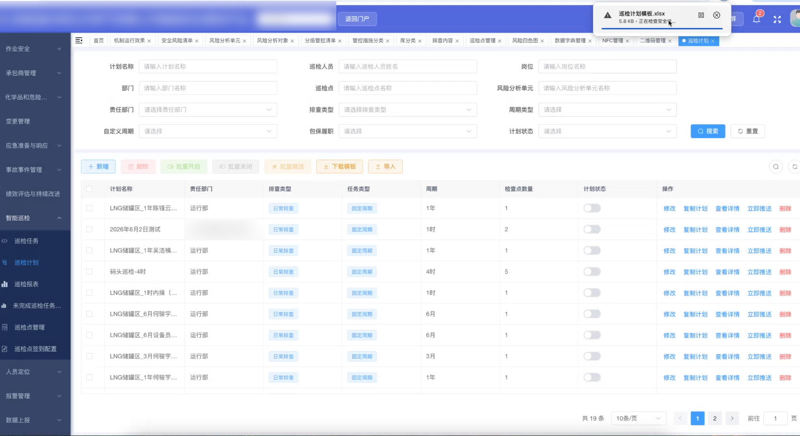

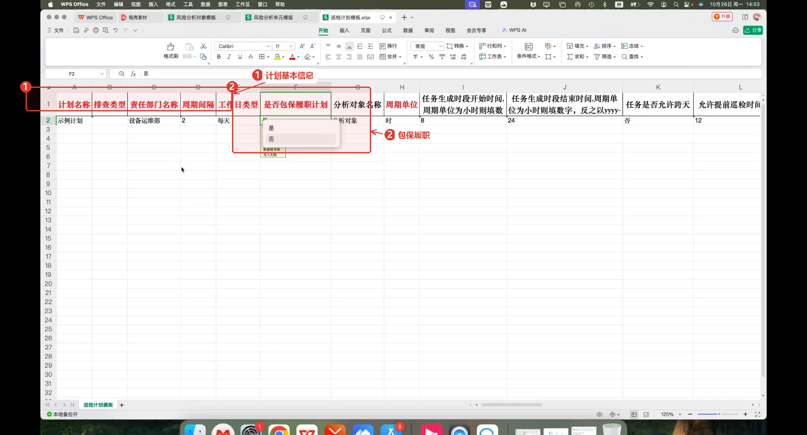

1. 下载《巡检计划模板》；
2. 填写计划基本信息、任务生成规则、巡检点信息、检查项目与检查标准；
3. 导入系统，导入后在计划列表中核对。

### 7.3 关键字段说明

| 分组 | 字段 | 说明 |
|---|---|---|
| 计划基本信息 | 计划名称、排查类型 | 排查类型按业务类型选择 |
| 计划基本信息 | 责任部门、周期间隔、周期单位 | 周期间隔与周期单位共同决定推送频率 |
| 计划基本信息 | 工作日类型 | 每天、仅法定工作日或仅非法定工作日；法定工作日由平台底座工作日历判定 |
| 计划基本信息 | 是否包保履职计划 | 用于重大危险源包保履职完成率统计 |
| 任务生成 | 任务生成时段开始/结束时间 | 任务在什么时间生成和推送 |
| 任务生成 | 是否允许跨天 | 跨班次任务可为“是”，如 23:00 至次日 04:00 |
| 任务生成 | 允许提前巡检时间 | 可在任务开始前提前开展的分钟数 |
| 任务生成 | 允许逾期补检时间 | 任务结束后仍可补做的分钟数 |
| 任务生成 | 是否立即推送 | 计划配置完成后立即推送，或按指定时段生成 |
| 执行规则 | 是否强制按顺序巡检 | 开启后必须按点位顺序执行，否则提示先完成前一点位 |
| 执行规则 | 推送岗位、推送人员 | 两列至少填写一列 |
| 巡检点 | 巡检点名称、责任部门、签收方式 | 与巡检点维护内容一致 |
| 检查内容 | 对象类型、检查对象 | 设备或自定义对象；自定义对象只需填写名称 |
| 检查内容 | 管控措施分类 1–3 级 | 一级必填，二级、三级可选 |
| 检查项目 | 检查项目、检查标准、检查类型、单位、合格区间、是否留痕 | 检查类型支持数值、选项、文本；留痕用于现场拍照 |

**规则示例：** 任务开始时间 08:30、允许提前巡检 30 分钟，则 08:00 起可开展；任务结束时间 12:00、允许逾期补检 30 分钟，则 12:30 前仍可补做。

### 7.4 常见问题

| 现象 | 排查方法 |
|---|---|
| 导入失败 | 检查模板列名、必填列、数值列格式 |
| 任务未按预期时间生成 | 检查任务生成时段、周期单位、是否立即推送 |
| 巡检顺序受限 | 检查“是否强制按顺序巡检”配置 |
| 推送岗位/人员为空 | 两列至少填写一列 |

## 八、隐患治理

### 8.1 功能说明

隐患治理用于隐患的登记、审批和闭环处理，入口包括：登记隐患、我的待办、我的已办、我发起的和全部隐患。

### 8.2 操作步骤

**菜单路径：** 隐患治理 → 登记隐患

步骤 1：登记隐患，填写隐患信息并提交，系统按配置的审批流程流转。

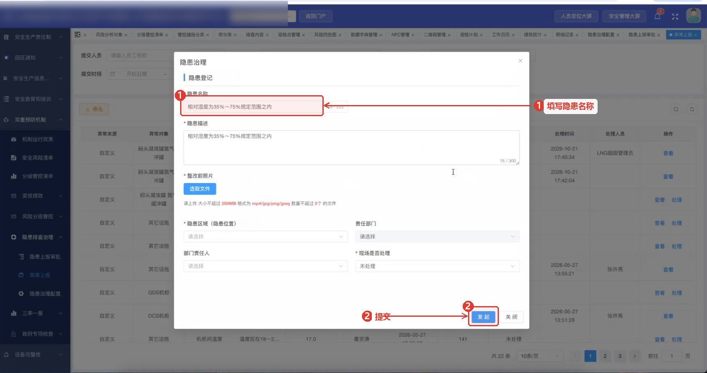

步骤 2：处理人在“我的待办”中接收并处理，处理完成后流转到“我的已办”。

步骤 3：现场发现异常时，可通过“异常上报”提交：支持实时提交，也支持巡检任务完成后批量提交。

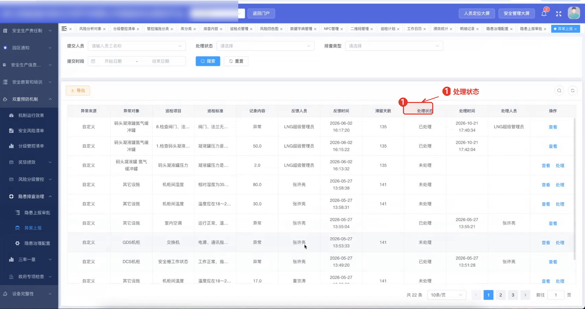

### 8.3 隐患治理配置

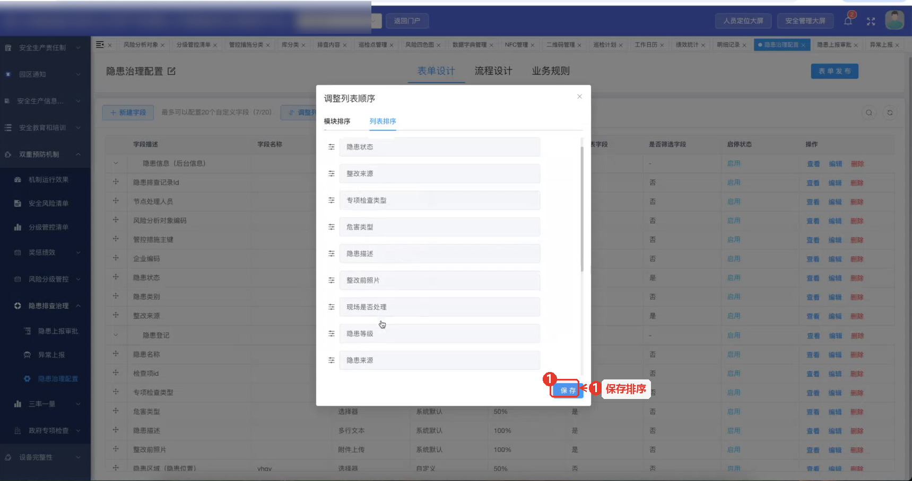

隐患治理配置通常由交付运营人员按企业需求配置：

| 配置内容 | 说明 |
|---|---|
| 表单设计 | 配置隐患登记表单的字段 |
| 流程设计 | 配置审批流转规则 |
| 字段配置 | 设置字段是否参与数据筛选、是否在列表展示，并调整列表顺序 |
| 自定义字段 | 支持新增自定义字段，额度为 20 个 |

### 8.4 常见问题

| 现象 | 排查方法 |
|---|---|
| 提交后没有进入审批 | 检查流程设计是否已完成配置 |
| 待办中没有记录 | 检查处理人设置和流程节点 |
| 列表看不到需要关注的字段 | 在字段配置中开启列表展示 |

## 九、奖惩绩效

### 9.1 功能说明

奖惩绩效按规则自动计算人员的考核积分和金额，覆盖排查任务和隐患治理两类业务。

### 9.2 操作步骤

**菜单路径：** 双重预防机制 → 奖惩绩效 → 绩效统计

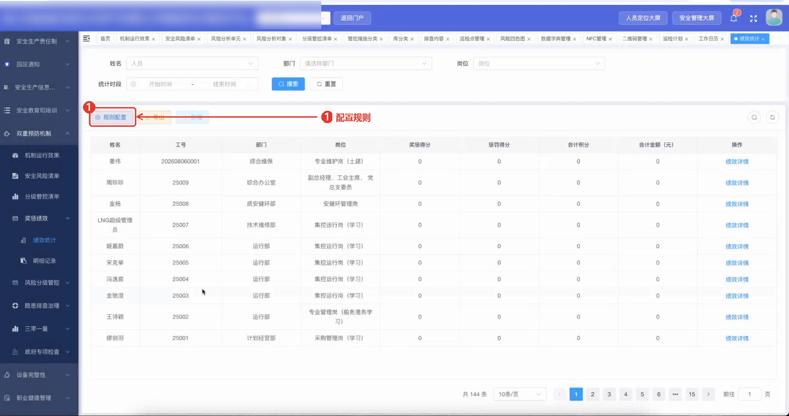

1. 配置奖惩规则，可按“是否按时完成任务、发现一般隐患、发现重大隐患、隐患及时整改、隐患超期未整改”等条件设置奖励或惩罚；

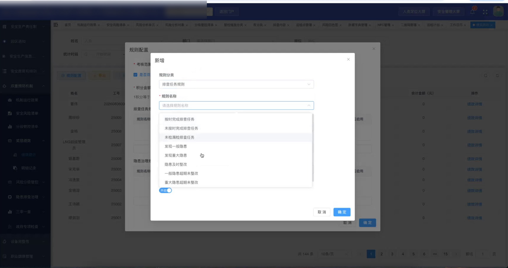

2. 设置积分与金额的换算关系；
3. 系统自动计算个人奖惩情况，可在详情中查看奖励明细、惩罚明细、合计积分和合计金额；
4. 支持导出明细记录。

### 9.3 常见问题

| 现象 | 排查方法 |
|---|---|
| 没有生成奖惩记录 | 检查规则是否启用、任务或隐患是否已闭环 |
| 积分与金额不符 | 检查积分与金额换算配置 |
| 明细与实际不一致 | 检查对应任务或隐患的处理记录 |

## 十、三率一量与园区任务闭环

### 10.1 三率一量

三率一量用于满足园区数据申报要求，数据关联管控措施分类，主要面向政府专项检查和上级平台上报。

- 与园区平台打通后，园区下发的内容可实时展示；
- 如未收到或需要重新获取，可使用任务刷新功能重新获取。

### 10.2 园区任务闭环

检查任务用于承接上级派发的任务，形成具体的下发任务并执行，执行完成后自动上报，形成“任务获取 → 任务下发 → 任务执行 → 任务上报”的闭环。

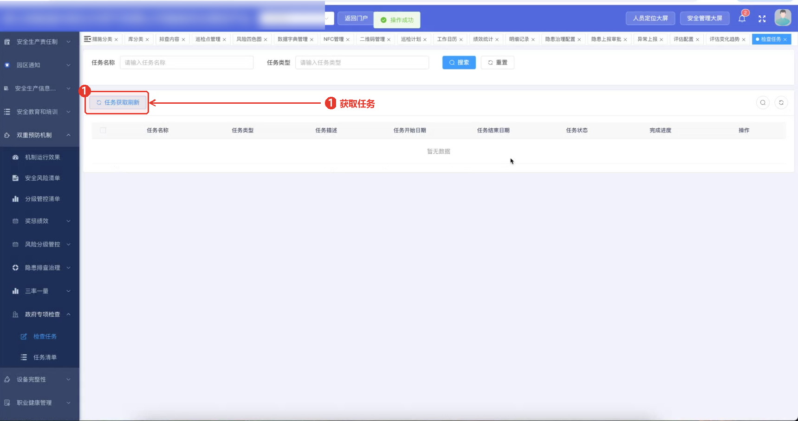

### 10.3 常见问题

| 现象 | 排查方法 |
|---|---|
| 三率一量数据为空 | 检查园区任务是否已获取，管控措施分类是否已维护 |
| 园区下发内容未显示 | 使用任务刷新重新获取 |
| 任务上报失败 | 检查任务清单执行状态和上报配置 |

## 附录 A 术语表

见 [术语表](术语表.md)。

## 附录 B 版本与范围

| 版本 | 日期 | 范围 |
|---|---|---|
| V0.1 | 2026-10-26 | 依据系统培训内容整理，覆盖双重预防机制模块十个章节；截图为原始录制画面按原生分辨率裁剪（成品宽度 ≥1665 px），图片门禁记录见《质量自检门禁》；正式发布前需完成脱敏和标注 |
